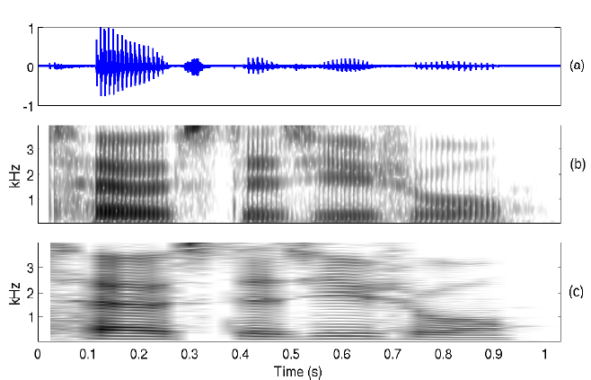
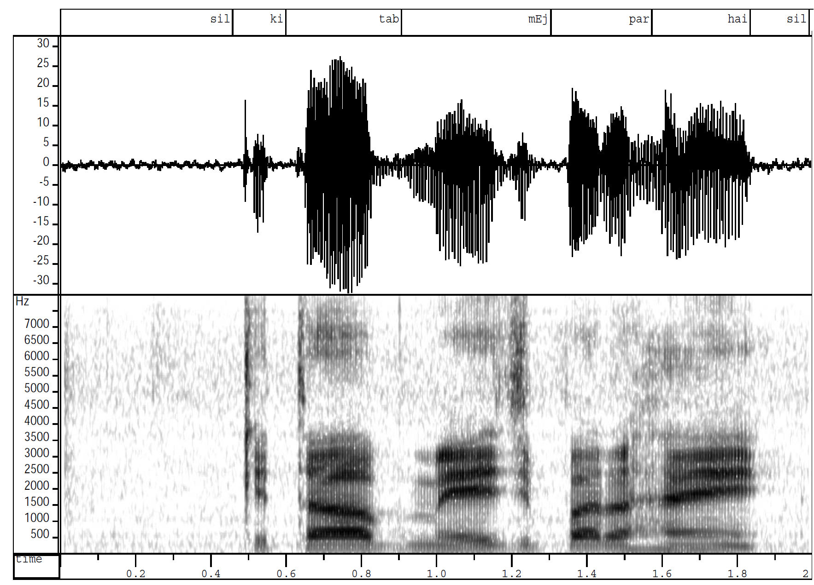

Spectrographic analysis of speech is one of the most widely used techniques for studying the acoustic-phonetic characteristics of different sound units in a language. It is an extension of the short-term spectral analysis, and primarily involves representation of the 3-D spectral information obtained by computing the magnitude spectrum over short overlapped window segments, i.e., 2-D spectral content varying with respect to time. The 3-D spectral information is represented on a 2-D plane with the X-axis representing time, Y-axis representing frequency, and the third dimension denoting the log-magnitude of the sinusoidal frequency components is converted to a proportional intensity of gray value. The resulting representation is referred to as a spectrogram.

Two popular spectrographic representations used for analysis are wideband spectrogram and narrowband spectrogram, depending on the spectral and temporal resolution preserved in the final representation in the frequency domain. In wideband (WB) spectrograms, the spectral information is averaged over frequency windows of bandwidths 100 to 200 Hz. The corresponding time window chosen is 5 to 10 ms, so as to maintain unit time-bandwidth product. An example of a wideband spectrogram computed with a time domain window size of 5 ms and a shift of 2.5 ms is shown in Figure 1(b).

   
    
   Figure 1:
    Spectrographic analysis of speech for an utterance "toast as usual"
    (a) Speech waveform
    (b) Wideband spectrogram
    (c) Narrowband spectrogram

Similarly, a narrowband (NB) spectrogram is computed using narrow filter function in the frequency domain, which in turn corresponds to a longer segment length in the time domain. Figure 1(c) shows a typical narrowband spectrogram computed for time domain window size of 50 ms, which correspond to a frequency domain bandwidth of about 20 Hz. Wideband spectrogram provides better temporal resolution, while narrowband spectrogram provides better resolution in the frequency domain. The periodicity in the speech signal due to vibration of the vocal folds is reflected as vertical striations in the WB spectrogram. Horizontal striations in the NB spectrogram are due to the window size being shorter than pitch period, as can be seen from Figs.1(b) and (c), respectively.

The dark bands in the spectrogram represents the resonances of a vocal tract system for the given sound unit. These resonances are also called as formant frequencies which represents the high energy portions in the frequency spectrum of a speech signal. The shape of the dark bands indicates, how the vocal tract shape changes from one sound unit to the other.

### 1. Identifying the Voiced/Unvoiced/Plosive/Silence regions using spectrogram:

Voiced: In the case of vowels a regular formant structure (3 to 4 formant frequencies) and pitch harmonics (vertical striations in the case of wideband spectrogram) are used for identifying the voiced regions, where as nasals and voiced stops low frequency regions and pitch harmonics are used as clues.

Unvoiced: Energy at high frequency regions and no regular formant structure

Plosive: A silence bar followed by energy at high frequency regions.

Silence: No frequency components (white region)

### 2. Observing the time varying system and excitation characteristics using spectrogram

So far we described the sound units interms of acoustic phonetics, time varying excitation and time varying system characteristics. Here we demonstrate the time varying excitation and system characteristics (given in Table 1 and Table 2 respectively) using the spectrogram of a speech signal. The speech waveform, its transcription and NB spectrogram are shown in Figure 2. Table 3 presents the spectral details of different sound units using spectrogram.

   
    
   Figure 2:
    Speech waveform and its wideband spectrogram
    for the utterance "kitAb mEj par hai"

**Table 1: Time varying excitation characteristics from spectrogram**

| Sound Unit | Excitation Characteristics                                                                                                              |
| ---------- | --------------------------------------------------------------------------------------------------------------------------------------- |
| /k/        | Silence bar before the burst is observed as no frequency components.                                                                    |
| /i/        | Vocal folds vibration can be observed in terms of pitch harmonics (vertical striations) in spectrogram.                                 |
| /t/        | Silence bar before the burst is observed as no frequency components.                                                                    |
| /A/        | Vocal folds vibration can be observed in terms of pitch harmonics (vertical striations) in spectrogram.                                 |
| /b/        | Vocal folds vibration and closure at lips is observed as pitch harmonics at low frequency portion of the spectrogram.                   |
| /m/        | Vocal folds vibration, closure at lips and opening of velum is observed as pitch harmonics at low frequency portion of the spectrogram. |
| /E/        | Vocal folds vibration can be observed in terms of pitch harmonics (vertical striations) in spectrogram.                                 |
| /j/        | Vocal folds vibration and closure at palatal is observed as pitch harmonics at high frequency portion of the spectrogram.               |
| /p/        | Silence bar before the burst is observed as no frequency components.                                                                    |
| /r/        | Vocal folds vibration and narrow opening at alveolar ridge is observed as pitch harmonics at lower formants in spectrogram.             |
| /h/        | No pitch harmonics are observed in spectrogram due to random nature in time domain.                                                     |
| /ai/       | Vocal folds vibration can be observed in terms of pitch harmonics (vertical striations) in spectrogram.                                 |

**Table 2: Time varying system characteristics from spectrogram**

| Sound Unit | System Characteristics                                                                                                                                                                                                                                                                         |
| ---------- | ---------------------------------------------------------------------------------------------------------------------------------------------------------------------------------------------------------------------------------------------------------------------------------------------- |
| /k/        | Complete closure at velum and release of constriction at velar position; observed as silence bar followed by energy at high frequency components (1700-4000 Hz).                                                                                                                               |
| /i/        | Tongue hump at front position of the vocal tract system and narrow opening of oral cavity; observed as regular formant structure with formant frequencies $F_1=320$ Hz, $F_2=1960$ Hz, $F_3=2530$ Hz.                                                                                          |
| /t/        | Complete closure at dental region and release of constriction at dental position; observed as silence bar followed by energy at high frequency components (lower energy than /k/).                                                                                                             |
| /A/        | Tongue hump at central position of the vocal tract system and wide opening of oral cavity; observed as regular formant structure with formant frequencies $F_1=640$ Hz, $F_2=1400$ Hz, $F_3=2610$ Hz.                                                                                          |
| /b/        | Closure at lips and radiation from cheeks and jaws; observed as low frequency components (<400 Hz).                                                                                                                                                                                            |
| /m/        | Opening of velum and closure at lips; formant structure observed, energy much lower (around 25 dB less) than normal vowels (may be due to following vowel /E/).                                                                                                                                |
| /E/        | Tongue hump at front position of the vocal tract system and moderate opening of oral cavity; observed as regular formant structure with formant frequencies $F_1=520$ Hz, $F_2=1880$ Hz, $F_3=2440$ Hz.                                                                                        |
| /j/        | Short discontinuity in formant structure due to silence bar; high frequency spectrum contains more energy; influence of /E/ seen as regular formants.                                                                                                                                          |
| /p/        | Closure of lips; no significant frequency spectrum observed.                                                                                                                                                                                                                                   |
| /a/        | Tongue hump at central position of the vocal tract system and wide opening of oral cavity; observed as regular formant structure with formant frequencies $F_1=680$ Hz, $F_2=1320$ Hz, $F_3=2280$ Hz.                                                                                          |
| /r/        | Narrow opening at alveolar ridge; only two formants observed $F_1=520$ Hz, $F_2=1400$ Hz (intensity about 30 dB lower than normal formants).                                                                                                                                                   |
| /h/        | Narrow constriction at velum; thin traces of first two formants, some discontinuities; energy very low; generally no significant frequency components.                                                                                                                                         |
| /ai/       | Tongue hump initially at central (due to /a/) and later at front (due to /i/); oral cavity widens then narrows; regular formant structure; transition from /a/ to /i/; initial formants $F_1=680$ Hz, $F_2=1720$ Hz, $F_3=2400$ Hz; final formants $F_1=280$ Hz, $F_2=2040$ Hz, $F_3=2520$ Hz. |

**Table 3: Spectral details for different sound units**

| Sound Unit     | Spectrogram Details                                                                                                 |
| -------------- | ------------------------------------------------------------------------------------------------------------------- |
| a              | Regular formant structure (730, 1090, 2440), pitch harmonics.                                                       |
| A              | Regular formant structure (520, 1190, 2390), pitch harmonics.                                                       |
| i              | Regular formant structure (270, 2290, 3010), pitch harmonics.                                                       |
| I              | Regular formant structure (390, 1990, 2550), pitch harmonics.                                                       |
| u              | Regular formant structure (300, 870, 2240), pitch harmonics.                                                        |
| U              | Regular formant structure (440, 1020, 2240), pitch harmonics.                                                       |
| e              | Regular formant structure (530, 1840, 2480), pitch harmonics.                                                       |
| E              | Regular formant structure (660, 1720, 2410), pitch harmonics.                                                       |
| o              | Regular formant structure (570, 840, 2410), pitch harmonics.                                                        |
| m, n           | Concentration of energy in low and midrange frequencies (nasals) with no prominent peaks, and with pitch harmonics. |
| s, sh          | Concentration of high frequency energies.                                                                           |
| k, ch, T, t, p | Concentration of high frequency energy.                                                                             |
| g, j, D, d, b  | Concentration of low frequency energy.                                                                              |
